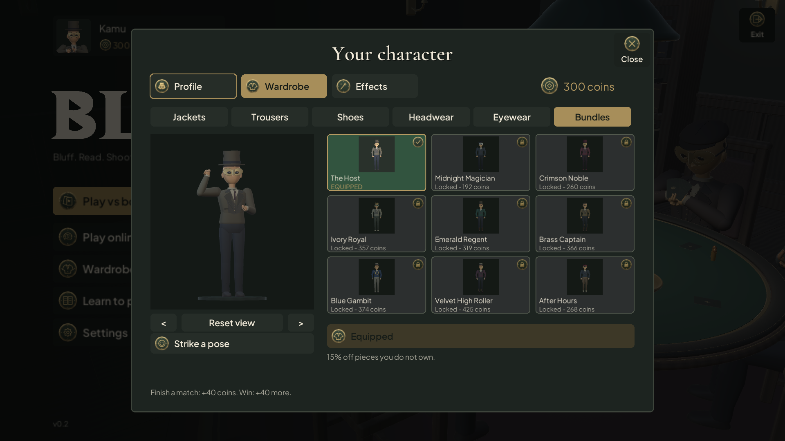
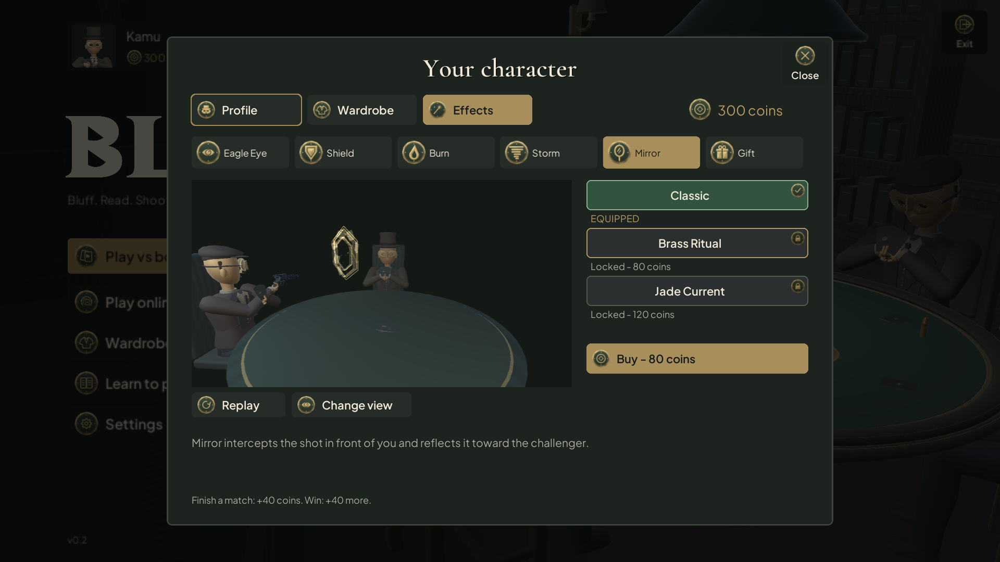
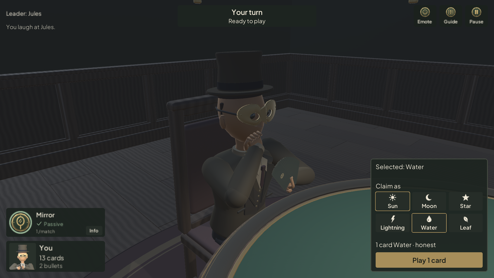
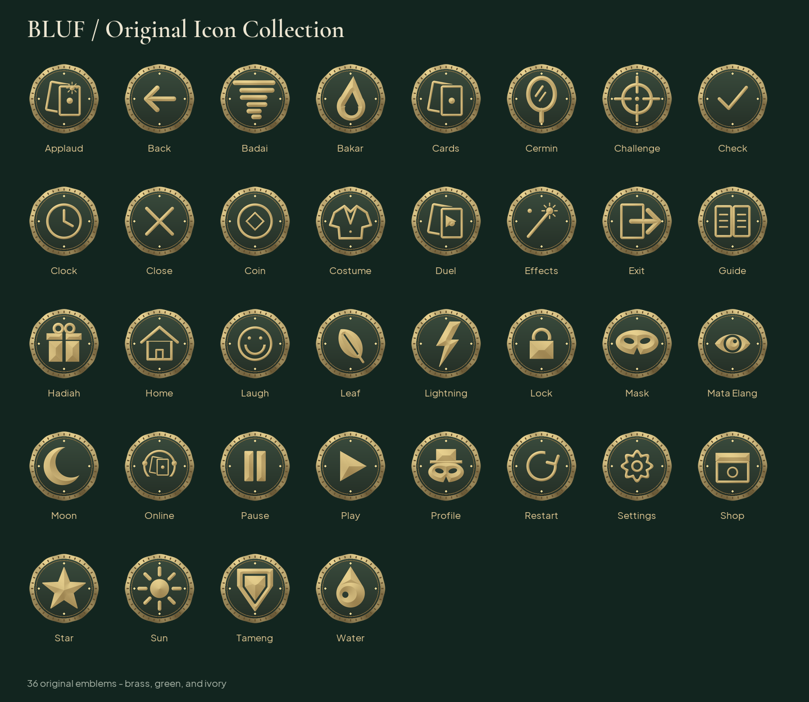

  

# BLUF: Masks & Elements

A first-person, four-player bluffing card game made with Unity. Play cards face down, claim an element, and decide whether to trust the next player or spend a bullet on a challenge.

## Open the project

1. Install **Unity 6.3 LTS, 6000.3.25f1** through Unity Hub.
2. Add this folder with **Add project from disk** and let Unity import assets and restore packages.
3. Open `Assets/Bluff/Scenes/MainMenu.unity` and press **Play**. The primary layout is 16:9.
4. If scene registrations are missing, use **Bluff > Setup Scenes + Build Settings**.

The project includes MainMenu, Loading, and Game scenes. Local generated folders such as Library, Temp, Logs, obj, and UserSettings are excluded from Git.

## How to play

Default rules for four players:

1. Each player receives **13 cards**, **2 bullets**, and **1 power card** when powers are enabled.
2. The round leader plays **1-3 cards** and claims an element. The claim may be truthful or a bluff.
3. Following players use the round's element or pass. The round leader cannot pass.
4. After a play, another player can choose **BLUFF!** to challenge, or let it pass.
5. A caught bluffer takes the pile and the challenger recovers their bullet. A mistaken challenger loses a bullet and takes the challenged cards.
6. When all other players pass consecutively, the pile burns and the last player to play leads the next round.
7. Empty your hand and survive the final challenge to win.

**Mask** cards match any element. Each **power is usable once per match**, subject to its conditions. Shield protects a play from challenges; its shop preview includes a sample impact without changing that rule. The interactive guide follows the active rules, including configurable bullet refunds and penalties.

## Controls

| Action | Control |
| --- | --- |
| Select a card | Left-click |
| Inspect a card | Hover |
| Play selected cards | Play cards / Enter |
| Pass | Pass / P |
| Challenge | BLUFF! / B / Space |
| Use a power | Click its icon when Ready |
| Look around | Hold right mouse button and move |
| Reset the view | R |
| React | Choose Laugh / Salute, then a recipient |
| Open the guide | Guide icon |
| Pause | Esc |

Enter and Space activate the focused UI button. B remains the dedicated challenge shortcut. Powers show Ready, Waiting, Armed, Passive, or Used as appropriate. The Eagle Eye ring measures its actual peek duration; it does not recharge the power. Emotes have a four-second cooldown. Choose a recipient to laugh at or salute. Your camera moves briefly to third person, showing your equipped character performing the gesture, then returns to first person. Important match actions interrupt the camera cut.

Large hands use multiple rows without pages. A two-hand grip supports larger fans. Cards stay attached to their hand anchor; table clearance moves the hands rather than separating the cards from the fingers. The pile count follows its table position and hides when it leaves the view or is obscured by the player's cards.

## Character, wardrobe, and effects

**Wardrobe** is the single Home entry for Profile, Wardrobe, and Effects. The profile shortcut opens the same screen.

- Rename the character with up to 24 characters.
- Mix **40 pieces** across jackets, trousers, shoes, headwear, and eyewear, or choose one of nine bundles. Bundles discount unowned pieces by 15%.
- Item cards show pictures rendered from the actual models. Preview the outfit in 3D, drag to rotate, scroll to zoom, or use **Strike a pose**. The model breathes and reacts to changes. New pieces include a velvet smoking jacket, ivory pleats, satin-stripe trousers, brogues, tassel loafers, and an ivory fedora.
- Equipped items use a green card and check badge; owned items use the normal panel; locked items are dimmed with a lock badge. The gold outline marks the current preview.
- Selecting an item only previews it. **Buy** unlocks it; **Equip** applies it.
- Each of six powers offers Classic, Brass Ritual, and Jade Current effects. Variants change shape, movement, and synthesized sound as well as color. Classic, metallic Brass Ritual, and flowing Jade Current have distinct sound envelopes and textures.
- Effect previews use the same `TablePowerEffect` renderer as matches, in a scene with seated characters, cards, and a table. **Replay** restarts the demonstration; **Change view** switches between the table view and an overview. Mirror faces the incoming shot, sits beyond the character's arms, and keeps its full expanding outline above the felt.
- Start with **300 coins**. Completing a match earns **40**, with **40 more** for the winner. Leaving early gives no reward.

Ownership, coins, name, and equipped cosmetics are stored locally in PlayerPrefs. The cosmetics key remains `bluff.cosmetics.v1`; existing bundle ownership migrates to individual pieces. There is no cloud economy or server purchase verification.

Outfits appear on portraits, entrance characters, table characters, and the player's sleeves. Internet rooms use protocol **v4**, including the modular outfit and emotes. All clients must use a compatible version.

## Original icons and typography

**36 original transparent PNG icons** live in `Assets/Bluff/Resources/Icons`. Brass medallions, green centers, and engraved symbols provide a shared visual language across Home, the wardrobe, HUD, pause menu, and guide.

The procedural artwork source is `SpriteFactory.Emblems.cs`. Regenerate it with **Bluff > Art > Generate Original Icons**. Use `UIKit.AddButtonIcon` or `UIKit.CreateLabeledIconButton` and the shared power/element emblems. Status information includes text as well as color.

UI type uses **Plus Jakarta Sans**; headings use **Cormorant Garamond**. Both fonts and their SIL Open Font Licenses are included in `Assets/Bluff/Resources/Fonts`. Their licenses do not define a license for the entire project.

## Internet rooms

Online play uses Netcode for GameObjects, Unity Transport, Relay, and Anonymous Authentication. The host runs the rules and sends each player only the cards they are entitled to see.

1. Link your Unity Cloud project in **Edit > Project Settings > Services**.
2. Enable Authentication and Relay, using matching service settings across builds.
3. Review service quotas before distributing public builds.
4. Verify host and client builds on different devices and networks.

Choose **Play online**, create a room, and share its code. Other players join and mark themselves ready; empty seats become bots. Online pause does not stop the shared match. Disconnects end the session; host migration and mid-match reconnect are not implemented.

No private service keys belong in the source. Missing service configuration produces an error instead of a simulated room.

## Source map

| Directory | Purpose |
| --- | --- |
| `Assets/Bluff/Editor` | Scene setup and art generation |
| `Assets/Bluff/Resources` | Shaders, original icons, logo, and fonts |
| `Assets/Bluff/Scenes` | Menu, loading, and gameplay scenes |
| `Assets/Bluff/Scripts/Core` | Game rules and bot decisions, independent of Unity |
| `Assets/Bluff/Scripts/Game/App` | Settings, cosmetics, and navigation |
| `Assets/Bluff/Scripts/Game/Gameplay` | Presentation, controller, and HUD |
| `Assets/Bluff/Scripts/Game/Networking` | Relay and host authority |
| `Assets/Bluff/Scripts/Game/UI` | UI, portraits, wardrobe, guide, and scene previews |
| `Assets/Bluff/Scripts/Game/World` | Characters, cards, camera, and effects |

## Entrance animation

The corridor has continuous wall panels, framed emblems, detailed sconces, and a full foreground floor. Entry follows approach, plant, reach, depress, pull, release, and walk-through phases. The right hand tracks the moving handle; a failed entry retains the Continue to table fallback.

## Verification scope

Targeted checks run in an isolated Unity 6000.3.25f1 project copy, preserving the open development project. The latest pass covers:

- Compilation and runtime captures of the wardrobe, power previews, gameplay, emotes, and the complete entrance sequence.
- Mirror outlines, line thickness, and fragments at 169 animation samples for all 36 seat/variant combinations. Minimum measured felt clearance is 3.3 cm. Live first-person and bot shots also confirm reflection uses the firing position after the gun recovers.
- Card/hand mesh intersections at 1, 6, 10, and 13 bot cards, with front and both side views. No intersections were detected in these sampled holding poses; the thumb-to-card gap is under 0.5 mm.
- Direct power activation, duplicate-click protection, an information-only details panel, Shield arming, and directed emote cooldown. Emote completion and interruption restore the camera and preserve selected cards.
- All 18 effect audio waveforms are distinct and remain below clipping, with a measured peak of 0.43. In-game playback follows animation speed.
- Protocol v4 round trips for all 24 directed emote combinations, rejection of invalid emotes and older protocol versions, and outfit encoding for all nine bundles.
- Legacy bundle ownership migration, buying and equipping the five added bundles, duplicate purchase protection, effect purchases, and persistence after reloading the local save.

Earlier targeted passes also covered 16:9 and 4:3 layouts, player card hover poses, and pile-label visibility.

These checks do not establish that every animation frame is collision-free. Multi-client cosmetic synchronization over internet Relay and WebGL releases still require separate verification. The verification editor can emit a Unity Search database exception during startup; this is separate from game compilation and runtime capture.
